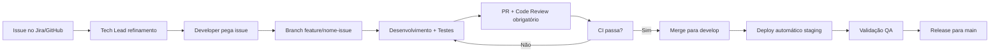

# Plano de Desenvolvimento Front-end - App Restaurante ADA EJ

[Voltar](../DOCUMENTACAO.md)
 
## 📋 Visão Geral

Este documento detalha o planejamento para configurar a base do projeto React que será utilizada por uma equipe de **15 desenvolvedores** divididos em múltiplas squads. O objetivo é entregar uma **fundação sólida** com arquitetura, design system, padrões de código e ferramentas configuradas para que as equipes foquem exclusivamente na criação de **components, hooks e pages**.

---

## 🎯 Stack Tecnológica Definida

| Tecnologia | Versão | Justificativa |
|------------|--------|---------------|
| **React** | 18.2.x (LTS) | Versão estável com suporte longo, Concurrent Features |
| **TypeScript** | 5.3.x | Tipagem estática obrigatória para escala de 15 devs |
| **Vite** | 5.x | Build ultra-rápido, HMR otimizado |
| **Tailwind CSS** | 3.4.x | Utility-first, design system consistente, bundle pequeno |
| **ESLint** | 8.56.x + Airbnb/TypeScript | Padrão de código rigoroso |
| **Prettier** | 3.2.x | Formatação automática |
| **React Router** | 6.21.x | Roteamento nativo SPA |
| **TanStack Query** | 5.x | Server state management, cache, dedup |
| **Zustand** | 4.4.x | Client state simples e performático |
| **React Hook Form** | 7.49.x | Formulários performáticos |
| **Zod** | 3.22.x | Validação schema-first |
| **Axios** | 1.6.x | HTTP client com interceptors |
| **Vitest** | 1.2.x | Testes unitários rápidos |
| **Testing Library** | 14.x | Testes centrados no usuário |
| **Storybook** | 7.6.x | Documentação de componentes |
| **Husky** | 9.0.x | Git hooks para qualidade |
| **lint-staged** | 15.2.x | Lint apenas em arquivos alterados |

---

## 🏗️ 1. Estrutura do Projeto (Clean Architecture Adaptada)

```
src/
├── app/                          # Configuração global da aplicação
│   ├── providers/                # Providers globais (Query, Auth, Theme)
│   ├── routes/                   # Configuração de rotas + lazy loading
│   └── styles/                   # Estilos globais, reset, variáveis CSS
│
├── core/                         # Núcleo compartilhado (singletons)
│   ├── api/                      # Configuração Axios, interceptors, base URL
│   ├── auth/                     # Auth context, tokens, refresh logic
│   ├── constants/                # Constantes globais (roles, status, enums)
│   ├── errors/                   # Error boundaries, error classes tipadas
│   ├── hooks/                    # Hooks transversais (useDebounce, useLocalStorage)
│   ├── stores/                   # Zustand stores globais (auth, ui, theme)
│   ├── types/                    # Tipos base (API responses, paginação)
│   ├── utils/                    # Utilitários puros (date, currency, validation)
│   └── validation/               # Schemas Zod reutilizáveis
│
├── domain/                       # Camada de domínio (regras de negócio puras)
│   ├── entities/                 # Interfaces das entidades (User, Mesa, Pedido, Comanda)
│   ├── repositories/             # Interfaces dos repositórios (contratos)
│   ├── use-cases/                # Casos de uso puros (ex: abrirComandaUseCase)
│   └── value-objects/            # Value objects (Money, CPF, Email, Quantity)
│
├── data/                         # Implementação de dados (adapters)
│   ├── api/                      # Endpoints da API (React Query hooks)
│   ├── repositories/             # Implementações dos repositórios
│   ├── mappers/                  # Transformação API ↔ Domain
│   └── mock/                     # Mocks para desenvolvimento/testes
│
├── presentation/                 # Camada de apresentação (UI)
│   ├── components/               # Componentes reutilizáveis (Design System)
│   │   ├── ui/                   # Primitivos (Button, Input, Card, Modal, Table)
│   │   ├── forms/                # Componentes de formulário compostos
│   │   ├── layout/               # Layout (Sidebar, Header, Footer, Container)
│   │   ├── feedback/             # Toast, Alert, Skeleton, Spinner, EmptyState
│   │   ├── navigation/           # Breadcrumbs, Tabs, Pagination, Menu
│   │   └── data-display/         # Badge, Avatar, Progress, StatCard, DataTable
│   │
│   ├── features/                 # Features por domínio de negócio
│   │   ├── auth/                 # Login, Register, ForgotPassword
│   │   ├── dashboard/            # Dashboard gerencial, caixas
│   │   ├── mesas/                # Mapa de mesas, gestão de mesas
│   │   ├── comandas/             # Abertura, visualização, fechamento
│   │   ├── pedidos/              # Lançamento, validação estoque, status
│   │   ├── produtos/             # CRUD produtos, categorias, marcas
│   │   ├── estoque/              # Entrada, relatórios, alertas
│   │   ├── funcionarios/         # Gestão usuários, cargos, permissões
│   │   ├── clientes/             # CRUD clientes, perfis
│   │   ├── fornecedores/         # CRUD fornecedores
│   │   ├── relatorios/           # Faturamento, produtos, estoque
│   │   ├── configuracoes/        # Restaurante, impressoras, setores
│   │   └── auditoria/            # Logs, histórico
│   │
│   ├── hooks/                    # Hooks de apresentação (useForm, useTable)
│   ├── pages/                    # Páginas roteáveis (composição de features)
│   ├── layouts/                  # Layouts de página (AuthLayout, DashboardLayout)
│   └── styles/                   # Tokens de design, tema Tailwind
│
├── shared/                       # Código verdadeiramente compartilhado
│   ├── components/               # Componentes genéricos sem regra de negócio
│   ├── hooks/                    # Hooks genéricos (useClickOutside, useMediaQuery)
│   ├── utils/                    # Utils genéricos (cn, formatters)
│   └── types/                    # Tipos utilitários (DeepPartial, Optional)
│
└── main.tsx                      # Entry point
```

---

## 🎨 2. Design System - Identidade Visual (Baseado na Prototipagem)

### 2.1 Paleta de Cores (Extraída de `Prototipagem/telas.md`)

```typescript
// tailwind.config.ts - cores customizadas
colors: {
  // Primária - Vermelho Tomate/Cereja (#E63946)
  primary: {
    50: '#fef0f0',
    100: '#fddddd',
    200: '#fab9b9',
    300: '#f58484',
    400: '#ee5151',
    500: '#E63946',  // MAIN
    600: '#d42d3a',
    700: '#b82330',
    800: '#961f28',
    900: '#7a1c23',
    950: '#410b10',
  },

  // Secundária - Amarelo Mostarda/Ouro (#FFB703)
  secondary: {
    50: '#fffbf0',
    100: '#fff3d1',
    200: '#ffe5a3',
    300: '#ffd366',
    400: '#ffc129',
    500: '#FFB703',  // MAIN
    600: '#e6a300',
    700: '#b88200',
    800: '#926500',
    900: '#775200',
    950: '#402b00',
  },

  // Fundo - Preto Carvão (#1E1E24) - Dark Mode Base
  background: {
    DEFAULT: '#1E1E24',      // Fundo principal
    secondary: '#252530',    // Cards, modais
    tertiary: '#2D2D3A',     // Inputs, borders
    hover: '#363646',        // Hover states
  },

  // Texto - Off-White (#F8F9FA)
  text: {
    primary: '#F8F9FA',      // Texto principal
    secondary: '#CBD5E1',    // Texto secundário
    muted: '#94A3B8',        // Placeholders, disabled
    inverse: '#1E1E24',      // Texto sobre cores claras
  },

  // Status das Mesas (do protótipo)
  status: {
    livre: '#22C55E',        // Verde - Mesa livre
    ocupada: '#3B82F6',      // Azul - Mesa ocupada
    conta: '#F97316',        // Laranja - Pedindo a conta
    reservada: '#8B5CF6',    // Roxo - Reservada (se necessário)
  },

  // Estados de Estoque (do protótipo)
  stock: {
    available: '#22C55E',    // Verde - Tem estoque
    low: '#F97316',          // Laranja - Estoque baixo
    empty: '#EF4444',        // Vermelho - Esgotado [0 un - Esgotado]
    disabled: '#64748B',     // Cinza - Item desabilitado
  },

  // Semânticas
  success: '#22C55E',
  warning: '#F97316',
  error: '#EF4444',
  info: '#3B82F6',
}
```

### 2.2 Tipografia

```typescript
fontFamily: {
  sans: ['Inter', 'system-ui', 'sans-serif'],  // Fonte principal
  mono: ['JetBrains Mono', 'monospace'],        // Código, números
  display: ['Poppins', 'system-ui', 'sans-serif'], // Headlines opcional
},
fontSize: {
  // Mobile-first, clamp para responsividade fluida
  'display-xl': ['clamp(2.5rem, 5vw + 1rem, 4rem)', { lineHeight: '1.1', fontWeight: '700' }],
  'display-lg': ['clamp(2rem, 4vw + 0.5rem, 3rem)', { lineHeight: '1.2', fontWeight: '700' }],
  'display-md': ['clamp(1.5rem, 3vw + 0.5rem, 2.25rem)', { lineHeight: '1.3', fontWeight: '600' }],
  'heading-xl': ['clamp(1.25rem, 2.5vw + 0.5rem, 1.875rem)', { lineHeight: '1.3', fontWeight: '600' }],
  'heading-lg': ['clamp(1.125rem, 2vw + 0.5rem, 1.5rem)', { lineHeight: '1.4', fontWeight: '600' }],
  'heading-md': ['clamp(1rem, 1.5vw + 0.5rem, 1.25rem)', { lineHeight: '1.4', fontWeight: '600' }],
  'heading-sm': ['clamp(0.875rem, 1vw + 0.5rem, 1rem)', { lineHeight: '1.5', fontWeight: '600' }],
  'body-lg': ['1.125rem', { lineHeight: '1.6' }],
  'body-md': ['1rem', { lineHeight: '1.6' }],
  'body-sm': ['0.875rem', { lineHeight: '1.5' }],
  'caption': ['0.75rem', { lineHeight: '1.5' }],
  'button': ['0.875rem', { lineHeight: '1.5', fontWeight: '500' }],
},
```

### 2.3 Espaçamento e Border Radius

```typescript
spacing: {
  // Scale base 4px
  0: '0',
  1: '0.25rem',   // 4px
  2: '0.5rem',    // 8px
  3: '0.75rem',   // 12px
  4: '1rem',      // 16px
  5: '1.25rem',   // 20px
  6: '1.5rem',    // 24px
  8: '2rem',      // 32px
  10: '2.5rem',   // 40px
  12: '3rem',     // 48px
  16: '4rem',     // 64px
  20: '5rem',     // 80px
  24: '6rem',     // 96px
},

borderRadius: {
  none: '0',
  sm: '0.25rem',    // 4px - inputs, badges
  DEFAULT: '0.5rem', // 8px - cards, buttons
  md: '0.75rem',    // 12px - modais, dropdowns
  lg: '1rem',       // 16px - containers grandes
  xl: '1.5rem',     // 24px - hero sections
  full: '9999px',   // pills, avatars
},
```

### 2.4 Sombras (Elevation para Dark Mode)

```typescript
boxShadow: {
  // Sombras suaves para modo escuro
  'xs': '0 1px 2px 0 rgb(0 0 0 / 0.3)',
  'sm': '0 1px 3px 0 rgb(0 0 0 / 0.4), 0 1px 2px -1px rgb(0 0 0 / 0.4)',
  'DEFAULT': '0 4px 6px -1px rgb(0 0 0 / 0.4), 0 2px 4px -2px rgb(0 0 0 / 0.3)',
  'md': '0 10px 15px -3px rgb(0 0 0 / 0.4), 0 4px 6px -4px rgb(0 0 0 / 0.3)',
  'lg': '0 20px 25px -5px rgb(0 0 0 / 0.4), 0 8px 10px -6px rgb(0 0 0 / 0.3)',
  'xl': '0 25px 50px -12px rgb(0 0 0 / 0.5)',
  'inner': 'inset 0 2px 4px 0 rgb(0 0 0 / 0.4)',
  // Focus rings
  'focus': '0 0 0 3px rgb(230 57 70 / 0.4)',  // Primary focus
  'focus-secondary': '0 0 0 3px rgb(255 183 3 / 0.4)', // Secondary focus
},
```

### 2.5 Breakpoints (Mobile-First - NFR003)

```typescript
screens: {
  'xs': '360px',      // Mínimo NFR003 - smartphones pequenos
  'sm': '640px',      // Mobile large
  'md': '768px',      // Tablet
  'lg': '1024px',     // Desktop
  'xl': '1280px',     // Desktop large
  '2xl': '1536px',    // 4K / Ultra-wide
  '3xl': '1920px',    // Full HD+
},
```

---

## 🧱 3. Componentes Base do Design System (Primitivos)

### 3.1 Componentes UI Obrigatórios

| Componente | Variantes | Estados | Prioridade |
|------------|-----------|---------|------------|
| **Button** | primary, secondary, outline, ghost, danger, success | default, hover, active, disabled, loading | 🔴 Crítico |
| **Input** | text, email, password, number, search, textarea | default, focus, error, disabled, readonly | 🔴 Crítico |
| **Select** | single, multi, searchable, async | default, focus, error, disabled, loading | 🔴 Crítico |
| **Checkbox** | single, group, indeterminate | default, hover, checked, disabled | 🔴 Crítico |
| **Radio** | single, group | default, checked, disabled | 🔴 Crítico |
| **Switch** | default, with-label | on, off, disabled | 🔴 Crítico |
| **Card** | default, outlined, elevated, interactive | default, hover, selected | 🔴 Crítico |
| **Modal** | default, fullscreen, bottom-sheet | open, closing, closed | 🔴 Crítico |
| **Dropdown** | single, multi, with-groups | open, closed, loading | 🟡 Alto |
| **Tabs** | default, underline, pills, vertical | active, inactive, disabled | 🟡 Alto |
| **Table** | default, striped, bordered, sortable, selectable | loading, empty, error | 🔴 Crítico |
| **DataTable** | server-side, pagination, filters, column-resize | loading, empty, error | 🔴 Crítico |
| **Toast** | success, error, warning, info, default | entering, visible, exiting | 🔴 Crítico |
| **Tooltip** | default, with-arrow | visible, hidden | 🟡 Alto |
| **Popover** | default, with-arrow | open, closed | 🟡 Alto |
| **Avatar** | image, initials, fallback, group | default, online, offline, busy | 🟢 Médio |
| **Badge** | default, dot, outline, soft | default, removable | 🟢 Médio |
| **Skeleton** | text, circular, rectangular, card | pulsing, wave, none | 🔴 Crítico |
| **Spinner** | default, dots, bars, ring | spinning | 🔴 Crítico |
| **Progress** | linear, circular, indeterminate | default, complete | 🟡 Alto |
| **Accordion** | single, multiple | open, closed, disabled | 🟢 Médio |
| **Breadcrumb** | default, with-separator, collapsible | default | 🟢 Médio |
| **Pagination** | default, with-select, simple | default, disabled | 🟡 Alto |
| **Alert** | info, success, warning, error, default | default, dismissible | 🟡 Alto |
| **EmptyState** | default, with-action, illustration | default | 🟡 Alto |

### 3.2 Componentes Compostos (Forms)

```typescript
// presentation/components/forms/
FormField/           // Label + Input + ErrorMessage + HelperText
FormSelect/          // Label + Select + ErrorMessage
FormCheckbox/        // Checkbox + Label + ErrorMessage
FormRadioGroup/      // RadioGroup + Legend + ErrorMessage
FormSwitch/          // Switch + Label
FormTextarea/        // Label + Textarea + ErrorMessage + CharCount
FormDatePicker/      // Label + DatePicker + ErrorMessage
FormFileUpload/      // Drag-drop + Preview + Progress + ErrorMessage
FormAutocomplete/    // Label + Autocomplete + ErrorMessage
```

---

## 📐 4. Padrões de Arquitetura e Código

### 4.1 Princípios SOLID Aplicados

| Princípio | Aplicação no Projeto |
|-----------|---------------------|
| **S** - Single Responsibility | Cada hook/component/use-case faz UMA coisa |
| **O** - Open/Closed | Components via `className` + `variant` props; extensão via composition |
| **L** - Liskov Substitution | Repository interfaces → implementations intercambiáveis |
| **I** - Interface Segregation | Hooks pequenos e focados (`useMesa`, `useComanda`, não `useSalão`) |
| **D** - Dependency Inversion | Domain depende de abstrações (Repository interfaces), Data implementa |

### 4.2 Padrões de Nomenclatura

```typescript
// Arquivos
// Components: PascalCase + sufixo descritivo
Button.tsx
Button.stories.tsx
Button.test.tsx
Button.module.css (se necessário)

// Hooks: camelCase + prefixo "use"
useAuth.ts
useMesa.ts
useDebounce.ts

// Types: PascalCase + sufixo semântico
type MesaEntity = { ... }
type MesaDTO = { ... }
type MesaFormData = { ... }
type UseMesaReturn = { ... }

// Constants: UPPER_SNAKE_CASE
const MESA_STATUS = { LIVRE: 'livre', OCUPADA: 'ocupada' } as const
const API_ENDPOINTS = { MESAS: '/mesas', COMANDAS: '/comandas' } as const

// CSS Classes: kebab-case (Tailwind utility-first)
// Evitar CSS customizado - usar @apply apenas em components/ui
```

### 4.3 Padrão de Componentes (Composition over Inheritance)

```typescript
// ✅ BOM - Compound Components Pattern
<Select>
  <Select.Trigger>
    <Select.Value placeholder="Selecione..." />
  </Select.Trigger>
  <Select.Content>
    <Select.Group>
      <Select.Label>Bebidas</Select.Label>
      <Select.Item value="chopp">Chopp IPA [42 un]</Select.Item>
      <Select.Item value="cerveja" disabled>Cerveja [0 un - Esgotado]</Select.Item>
    </Select.Group>
  </Select.Content>
</Select>

// ✅ BOM - Render Props / Slots para flexibilidade
<DataTable
  columns={columns}
  data={pedidos}
  rowKey="id"
  renderRowActions={(row) => (
    <ActionMenu items={[
      { label: 'Ver detalhes', onClick: () => view(row) },
      { label: 'Cancelar', variant: 'danger', onClick: () => cancel(row) },
    ]} />
  )}
/>
```

### 4.4 Gerenciamento de Estado

```typescript
// 1. Server State → TanStack Query (React Query)
//    - Cache automático, dedup, refetch, pagination, mutations
//    - hooks em data/api/ (ex: useMesas, useCreateComanda)

// 2. Client Global State → Zustand (stores em core/stores/)
//    - AuthStore: user, token, permissions, login/logout
//    - UIStore: sidebarOpen, theme, toasts, modals
//    - PedidoStore: carrinho temporário (Em Andamento)

// 3. Client Local State → useState / useReducer
//    - Form state (React Hook Form)
//    - UI ephemeral (isDropdownOpen, activeTab)

// 4. URL State → React Router (searchParams)
//    - Filtros, paginação, sorting compartilháveis
```

### 4.5 Data Fetching Pattern (TanStack Query)

```typescript
// data/api/mesas.ts
export const mesasKeys = {
  all: ['mesas'] as const,
  lists: () => [...mesasKeys.all, 'list'] as const,
  list: (filters: MesaFilters) => [...mesasKeys.lists(), filters] as const,
  details: () => [...mesasKeys.all, 'detail'] as const,
  detail: (id: string) => [...mesasKeys.details(), id] as const,
}

// Query hook
export function useMesas(filters: MesaFilters = {}) {
  return useQuery({
    queryKey: mesasKeys.list(filters),
    queryFn: () => mesaApi.getAll(filters),
    staleTime: 30_000, // 30s
    placeholderData: (prev) => prev, // keep previous data while fetching
  })
}

// Mutation hook
export function useCreateMesa() {
  const queryClient = useQueryClient()
  return useMutation({
    mutationFn: mesaApi.create,
    onSuccess: () => {
      queryClient.invalidateQueries({ queryKey: mesasKeys.lists() })
      toast.success('Mesa criada com sucesso')
    },
    onError: (error) => toast.error(error.message),
  })
}
```

---

## 🔐 5. Autenticação e Autorização (RBAC)

### 5.1 Estrutura de Permissões (Baseado em RN013)

```typescript
// core/constants/permissions.ts
export const PERMISSIONS = {
  // Garçom
  COMANDA_ABRIR: 'comanda:abrir',
  COMANDA_VISUALIZAR: 'comanda:visualizar',
  PEDIDO_CRIAR: 'pedido:criar',
  PEDIDO_EDITAR_EM_ANDAMENTO: 'pedido:editar:em_andamento',
  PEDIDO_ALTERAR_STATUS: 'pedido:alterar_status',
  PEDIDO_CANCELAR: 'pedido:cancelar',
  CLIENTE_BUSCAR: 'cliente:buscar',
  CLIENTE_CRIAR: 'cliente:criar',

  // Caixa (inclui Garçom +)
  MESA_GERENCIAR: 'mesa:gerenciar',
  PRODUTO_GERENCIAR: 'produto:gerenciar',
  CATEGORIA_GERENCIAR: 'categoria:gerenciar',
  MARCA_GERENCIAR: 'marca:gerenciar',
  FORNECEDOR_GERENCIAR: 'fornecedor:gerenciar',
  ESTOQUE_ENTRADA: 'estoque:entrada',
  CARDAPIO_GERENCIAR: 'cardapio:gerenciar',
  COMANDA_FECHAR: 'comanda:fechar',
  RELATORIO_FATURAMENTO: 'relatorio:faturamento',
  RELATORIO_ESTOQUE: 'relatorio:estoque',
  IMPRESSORA_GERENCIAR: 'impressora:gerenciar',

  // Gerente (todas +)
  FUNCIONARIO_GERENCIAR: 'funcionario:gerenciar',
  CARGO_GERENCIAR: 'cargo:gerenciar',
  PERMISSAO_GERENCIAR: 'permissao:gerenciar',
  RESTAURANTE_GERENCIAR: 'restaurante:gerenciar',
  CONFIGURACAO_GERENCIAR: 'configuracao:gerenciar',
  AUDITORIA_VISUALIZAR: 'auditoria:visualizar',
  LGPD_ANONIMIZAR: 'lgpd:anonimizar',
} as const

export const ROLE_PERMISSIONS: Record<UserRole, readonly string[]> = {
  GARCOM: [
    PERMISSIONS.COMANDA_ABRIR,
    PERMISSIONS.COMANDA_VISUALIZAR,
    PERMISSIONS.PEDIDO_CRIAR,
    PERMISSIONS.PEDIDO_EDITAR_EM_ANDAMENTO,
    PERMISSIONS.PEDIDO_ALTERAR_STATUS,
    PERMISSIONS.PEDIDO_CANCELAR,
    PERMISSIONS.CLIENTE_BUSCAR,
    PERMISSIONS.CLIENTE_CRIAR,
  ],
  CAIXA: [
    // ... todas do garçom + caixa
  ],
  GERENTE: Object.values(PERMISSIONS),
}
```

### 5.2 Hook de Permissão

```typescript
// core/hooks/usePermissions.ts
export function usePermissions() {
  const { user } = useAuthStore()
  
  const hasPermission = useCallback((permission: string) => {
    if (!user) return false
    const rolePermissions = ROLE_PERMISSIONS[user.cargo] || []
    return rolePermissions.includes(permission)
  }, [user])

  const hasAnyPermission = useCallback((permissions: string[]) => {
    return permissions.some(hasPermission)
  }, [hasPermission])

  const hasAllPermissions = useCallback((permissions: string[]) => {
    return permissions.every(hasPermission)
  }, [hasPermission])

  return { hasPermission, hasAnyPermission, hasAllPermissions }
}

// Uso no componente
function MesaCard({ mesa }: { Mesa: MesaEntity }) {
  const { hasPermission } = usePermissions()
  
  return (
    <Card className={cn(mesa.status === 'LIVRE' && 'border-green-500')}>
      <CardHeader>
        <CardTitle>{mesa.identificacao}</CardTitle>
        {hasPermission(PERMISSIONS.MESA_GERENCIAR) && (
          <MenuButton actions={[
            { label: 'Editar', onClick: () => edit(mesa) },
            { label: 'Excluir', variant: 'danger', onClick: () => delete(mesa) },
          ]} />
        )}
      </CardHeader>
    </Card>
  )
}
```

### 5.3 Route Guards

```typescript
// app/routes/guards.tsx
export function ProtectedRoute({
  children,
  requiredPermissions,
  fallback = <Navigate to="/unauthorized" replace />,
}: {
  children: React.ReactNode
  requiredPermissions?: string[]
  fallback?: React.ReactNode
}) {
  const { isAuthenticated } = useAuthStore()
  const { hasAllPermissions } = usePermissions()

  if (!isAuthenticated) {
    return <Navigate to="/login" replace state={{ from: location }} />
  }

  if (requiredPermissions && !hasAllPermissions(requiredPermissions)) {
    return fallback
  }

  return <>{children}</>
}

// Uso nas rotas
<Route
  path="/mesas"
  element={
    <ProtectedRoute requiredPermissions={[PERMISSIONS.MESA_GERENCIAR]}>
      <MesaPage />
    </ProtectedRoute>
  }
/>
```

---

## 🛣️ 6. Roteamento e Lazy Loading

### 6.1 Estrutura de Rotas

```typescript
// app/routes/index.tsx
const router = createBrowserRouter([
  {
    path: '/',
    element: <PublicLayout />,
    children: [
      { index: true, element: <Navigate to="/login" replace /> },
      { path: 'login', element: <LoginPage /> },
      { path: 'unauthorized', element: <UnauthorizedPage /> },
    ],
  },
  {
    path: '/app',
    element: <ProtectedRoute><DashboardLayout /></ProtectedRoute>,
    children: [
      { index: true, element: <Navigate to="/app/dashboard" replace /> },
      
      // Dashboard (Todos)
      { path: 'dashboard', element: <DashboardPage /> },
      
      // Garçom
      { 
        path: 'mesas', 
        element: <ProtectedRoute requiredPermissions={[PERMISSIONS.COMANDA_VISUALIZAR]}>
          <MesasPage />
        </ProtectedRoute> 
      },
      { 
        path: 'mesa/:mesaId', 
        element: <ProtectedRoute requiredPermissions={[PERMISSIONS.COMANDA_VISUALIZAR]}>
          <MesaDetailPage />
        </ProtectedRoute> 
      },
      { 
        path: 'comanda/:comandaId', 
        element: <ProtectedRoute requiredPermissions={[PERMISSIONS.COMANDA_VISUALIZAR]}>
          <ComandaPage />
        </ProtectedRoute> 
      },
      { 
        path: 'pedido/novo/:comandaId', 
        element: <ProtectedRoute requiredPermissions={[PERMISSIONS.PEDIDO_CRIAR]}>
          <NovoPedidoPage />
        </ProtectedRoute> 
      },

      // Caixa/Gerente
      { 
        path: 'mesas/gerenciar', 
        element: <ProtectedRoute requiredPermissions={[PERMISSIONS.MESA_GERENCIAR]}>
          <GerenciarMesasPage />
        </ProtectedRoute> 
      },
      { 
        path: 'produtos', 
        element: <ProtectedRoute requiredPermissions={[PERMISSIONS.PRODUTO_GERENCIAR]}>
          <ProdutosPage />
        </ProtectedRoute> 
      },
      { 
        path: 'estoque', 
        element: <ProtectedRoute requiredPermissions={[PERMISSIONS.ESTOQUE_ENTRADA]}>
          <EstoquePage />
        </ProtectedRoute> 
      },
      { 
        path: 'comandas/fechamento', 
        element: <ProtectedRoute requiredPermissions={[PERMISSIONS.COMANDA_FECHAR]}>
          <FechamentoComandaPage />
        </ProtectedRoute> 
      },
      { 
        path: 'relatorios', 
        element: <ProtectedRoute requiredPermissions={[PERMISSIONS.RELATORIO_FATURAMENTO]}>
          <RelatoriosPage />
        </ProtectedRoute> 
      },
      { 
        path: 'configuracoes', 
        element: <ProtectedRoute requiredPermissions={[PERMISSIONS.CONFIGURACAO_GERENCIAR]}>
          <ConfiguracoesPage />
        </ProtectedRoute> 
      },

      // Gerente
      { 
        path: 'funcionarios', 
        element: <ProtectedRoute requiredPermissions={[PERMISSIONS.FUNCIONARIO_GERENCIAR]}>
          <FuncionariosPage />
        </ProtectedRoute> 
      },
      { 
        path: 'cargos', 
        element: <ProtectedRoute requiredPermissions={[PERMISSIONS.CARGO_GERENCIAR]}>
          <CargosPage />
        </ProtectedRoute> 
      },
      { 
        path: 'auditoria', 
        element: <ProtectedRoute requiredPermissions={[PERMISSIONS.AUDITORIA_VISUALIZAR]}>
          <AuditoriaPage />
        </ProtectedRoute> 
      },
    ],
  },
  { path: '*', element: <NotFoundPage /> },
])
```

### 6.2 Code Splitting por Feature

```typescript
// Lazy loading automático por feature
const MesasPage = lazy(() => import('@/presentation/features/mesas/MesasPage'))
const ProdutosPage = lazy(() => import('@/presentation/features/produtos/ProdutosPage'))
const RelatoriosPage = lazy(() => import('@/presentation/features/relatorios/RelatoriosPage'))

// Wrapper com Suspense + Error Boundary
function LazyRoute({ children }: { children: React.ReactNode }) {
  return (
    <ErrorBoundary fallback={<PageErrorFallback />}>
      <Suspense fallback={<PageSkeleton />}>
        {children}
      </Suspense>
    </ErrorBoundary>
  )
}
```

---

## 🎯 7. Configuração de Qualidade de Código

### 7.1 ESLint Config (eslint.config.js - Flat Config)

```javascript
// eslint.config.js
import js from '@eslint/js'
import tseslint from 'typescript-eslint'
import react from 'eslint-plugin-react'
import reactHooks from 'eslint-plugin-react-hooks'
import jsxA11y from 'eslint-plugin-jsx-a11y'
import tailwindcss from 'eslint-plugin-tailwindcss'
import importPlugin from 'eslint-plugin-import'
import unusedImports from 'eslint-plugin-unused-imports'
import prettier from 'eslint-plugin-prettier'

export default tseslint.config(
  { ignores: ['dist/', 'node_modules/', '.turbo/', 'coverage/', '*.config.*'] },
  
  js.configs.recommended,
  ...tseslint.configs.recommendedTypeChecked,
  ...tseslint.configs.stylisticTypeChecked,
  
  react.configs.recommended,
  react.configs['jsx-runtime'],
  reactHooks.configs.recommended,
  jsxA11y.configs.recommended,
  
  {
    plugins: {
      tailwindcss,
      import: importPlugin,
      'unused-imports': unusedImports,
      prettier,
    },
    rules: {
      // TypeScript
      '@typescript-eslint/no-unused-vars': ['error', { argsIgnorePattern: '^_' }],
      '@typescript-eslint/consistent-type-imports': 'error',
      '@typescript-eslint/no-floating-promises': 'warn',
      '@typescript-eslint/require-await': 'warn',
      
      // React
      'react/self-closing-comp': 'error',
      'react/jsx-max-props-per-line': ['error', { maximum: 3 }],
      'react/no-unstable-nested-components': 'warn',
      
      // Import ordering
      'import/order': [
        'error',
        {
          groups: ['builtin', 'external', 'internal', 'parent', 'sibling', 'index'],
          pathGroups: [
            { pattern: '@/**', group: 'internal', position: 'after' },
            { pattern: '@/core/**', group: 'internal', position: 'after' },
            { pattern: '@/domain/**', group: 'internal', position: 'after' },
            { pattern: '@/data/**', group: 'internal', position: 'after' },
            { pattern: '@/presentation/**', group: 'internal', position: 'after' },
            { pattern: '@/shared/**', group: 'internal', position: 'after' },
          ],
          pathGroupsExcludedImportTypes: ['builtin'],
          alphabetize: { order: 'asc', caseInsensitive: true },
          'newlines-between': 'always',
        },
      ],
      
      // Unused imports
      'unused-imports/no-unused-imports': 'error',
      'unused-imports/no-unused-vars': [
        'warn',
        { vars: 'all', varsIgnorePattern: '^_', args: 'after-used', argsIgnorePattern: '^_' },
      ],
      
      // Tailwind
      'tailwindcss/no-custom-classname': 'warn',
      'tailwindcss/enforces-shorthand': 'error',
      'tailwindcss/migration-from-tailwind-2': 'warn',
      'tailwindcss/migration-from-tailwind-3': 'warn',
      
      // Prettier
      'prettier/prettier': 'error',
    },
    settings: {
      'import/resolver': {
        typescript: { alwaysTryTypes: true, project: './tsconfig.json' },
        node: { extensions: ['.js', '.jsx', '.ts', '.tsx'] },
      },
      tailwindcss: { config: 'tailwind.config.ts' },
      react: { version: '18.2' },
    },
  },
  
  // Test files - regras mais flexíveis
  {
    files: ['**/*.test.{ts,tsx}', '**/*.spec.{ts,tsx}', '**/__mocks__/**'],
    rules: {
      '@typescript-eslint/no-explicit-any': 'off',
      '@typescript-eslint/no-non-null-assertion': 'off',
      'react/no-unstable-nested-components': 'off',
    },
  },
  
  // Stories - sem regras de a11y estritas
  {
    files: ['**/*.stories.{ts,tsx}'],
    rules: {
      'jsx-a11y/anchor-is-valid': 'off',
      'jsx-a11y/click-events-have-key-events': 'off',
      'jsx-a11y/no-noninteractive-element-interactions': 'off',
    },
  }
)
```

### 7.2 Prettier Config

```javascript
// prettier.config.js
export default {
  printWidth: 100,
  tabWidth: 2,
  useTabs: false,
  semi: true,
  singleQuote: true,
  quoteProps: 'consistent',
  jsxSingleQuote: true,
  trailingComma: 'es5',
  bracketSpacing: true,
  bracketSameLine: false,
  arrowParens: 'always',
  endOfLine: 'lf',
  plugins: ['prettier-plugin-tailwindcss', 'prettier-plugin-organize-imports'],
  tailwindConfig: './tailwind.config.ts',
  organizeImportsSkipDestructiveCodeActions: true,
}
```

### 7.3 TypeScript Config (Strict Mode)

```json
// tsconfig.json
{
  "compilerOptions": {
    "target": "ES2022",
    "useDefineForClassFields": true,
    "lib": ["ES2022", "DOM", "DOM.Iterable"],
    "module": "ESNext",
    "skipLibCheck": true,
    "moduleResolution": "bundler",
    "allowImportingTsExtensions": true,
    "resolveJsonModule": true,
    "isolatedModules": true,
    "noEmit": true,
    "jsx": "react-jsx",
    
    // Strict mode - OBRIGATÓRIO para 15 devs
    "strict": true,
    "noUncheckedIndexedAccess": true,
    "exactOptionalPropertyTypes": true,
    "noImplicitReturns": true,
    "noFallthroughCasesInSwitch": true,
    "noUnusedLocals": true,
    "noUnusedParameters": true,
    
    "baseUrl": ".",
    "paths": {
      "@/*": ["src/*"],
      "@core/*": ["src/core/*"],
      "@domain/*": ["src/domain/*"],
      "@data/*": ["src/data/*"],
      "@presentation/*": ["src/presentation/*"],
      "@shared/*": ["src/shared/*"],
      "@app/*": ["src/app/*"]
    }
  },
  "include": ["src", "vite.config.ts"],
  "references": [{ "path": "./tsconfig.node.json" }]
}
```

### 7.4 Husky + lint-staged

```json
// package.json scripts
{
  "scripts": {
    "prepare": "husky install",
    "lint": "eslint . --ext ts,tsx --report-unused-disable-directives --max-warnings 0",
    "lint:fix": "eslint . --ext ts,tsx --fix",
    "format": "prettier --write \"src/**/*.{ts,tsx,json,md,css}\"",
    "format:check": "prettier --check \"src/**/*.{ts,tsx,json,md,css}\"",
    "typecheck": "tsc --noEmit",
    "test": "vitest run",
    "test:watch": "vitest",
    "test:coverage": "vitest run --coverage",
    "storybook": "storybook dev -p 6006",
    "build:storybook": "storybook build",
    "check": "npm run typecheck && npm run lint && npm run format:check"
  },
  "lint-staged": {
    "*.{ts,tsx}": ["eslint --fix", "prettier --write"],
    "*.{json,md,css}": ["prettier --write"]
  }
}
```

---

## 📦 8. Configuração Inicial do Projeto (Passo a Passo)

### 8.1 Comandos de Criação

```bash
# 1. Criar projeto com Vite + React + TypeScript
npm create vite@latest app-restaurante -- --template react-ts

cd app-restaurante

# 2. Instalar dependências de produção
npm install \
  react@18.2.0 react-dom@18.2.0 \
  react-router-dom@6.21.0 \
  @tanstack/react-query@5.17.0 \
  zustand@4.4.0 \
  react-hook-form@7.49.0 \
  @hookform/resolvers@3.3.0 \
  zod@3.22.0 \
  axios@1.6.0 \
  clsx@2.1.0 \
  tailwind-merge@2.2.0 \
  lucide-react@0.303.0 \
  date-fns@3.2.0 \
  sonner@1.3.0 \
  @radix-ui/react-slot@1.0.2 \
  @radix-ui/react-dialog@1.0.5 \
  @radix-ui/react-dropdown-menu@2.0.6 \
  @radix-ui/react-select@2.0.0 \
  @radix-ui/react-tabs@1.0.4 \
  @radix-ui/react-tooltip@1.0.7 \
  @radix-ui/react-avatar@1.0.4 \
  @radix-ui/react-checkbox@1.0.4 \
  @radix-ui/react-switch@1.0.3 \
  @radix-ui/react-label@2.0.2 \
  @radix-ui/react-separator@1.0.3 \
  @radix-ui/react-progress@1.0.3 \
  @radix-ui/react-scroll-area@1.0.5 \
  @radix-ui/react-hover-card@1.0.7 \
  @radix-ui/react-popover@1.0.7 \
  @radix-ui/react-accordion@1.1.2

# 3. Instalar dependências de desenvolvimento
npm install -D \
  typescript@5.3.0 \
  vite@5.0.0 \
  @vitejs/plugin-react@4.2.0 \
  tailwindcss@3.4.0 \
  postcss@8.4.33 \
  autoprefixer@10.4.17 \
  eslint@8.56.0 \
  @eslint/js@8.56.0 \
  typescript-eslint@7.0.0 \
  eslint-plugin-react@7.33.0 \
  eslint-plugin-react-hooks@4.6.0 \
  eslint-plugin-jsx-a11y@6.8.0 \
  eslint-plugin-import@2.29.0 \
  eslint-plugin-unused-imports@3.1.0 \
  eslint-plugin-tailwindcss@0.10.0 \
  eslint-plugin-prettier@5.1.0 \
  prettier@3.2.0 \
  prettier-plugin-tailwindcss@0.5.0 \
  prettier-plugin-organize-imports@3.2.0 \
  vitest@1.2.0 \
  @vitest/coverage-v8@1.2.0 \
  @testing-library/react@14.1.0 \
  @testing-library/jest-dom@6.4.0 \
  @testing-library/user-event@14.5.0 \
  jsdom@24.0.0 \
  @types/react@18.2.0 \
  @types/react-dom@18.2.0 \
  @types/node@20.11.0 \
  husky@9.0.0 \
  lint-staged@15.2.0 \
  storybook@7.6.0 \
  @storybook/react@7.6.0 \
  @storybook/react-vite@7.6.0 \
  @storybook/addon-essentials@7.6.0 \
  @storybook/addon-interactions@7.6.0 \
  @storybook/addon-links@7.6.0 \
  @storybook/blocks@7.6.0 \
  @storybook/testing-library@0.2.0 \
  storybook-addon-paddings@4.1.0 \
  storybook-addon-viewport@7.6.0 \
  @chromatic-com/storybook@1.2.0

# 4. Inicializar Tailwind
npx tailwindcss init -p

# 5. Inicializar Husky
npx husky install
npx husky add .husky/pre-commit "npx lint-staged"
npx husky add .husky/commit-msg "npx --no-install commitlint --edit $1"
```

### 8.2 Estrutura de Pastas Inicial

```bash
# Criar estrutura completa
mkdir -p src/app/{providers,routes,styles}
mkdir -p src/core/{api,auth,constants,errors,hooks,stores,types,utils,validation}
mkdir -p src/domain/{entities,repositories,use-cases,value-objects}
mkdir -p src/data/{api,repositories,mappers,mock}
mkdir -p src/presentation/components/{ui,forms,layout,feedback,navigation,data-display}
mkdir -p src/presentation/features/{auth,dashboard,mesas,comandas,pedidos,produtos,estoque,funcionarios,clientes,fornecedores,relatorios,configuracoes,auditoria}
mkdir -p src/presentation/{hooks,pages,layouts,styles}
mkdir -p src/shared/{components,hooks,utils,types}
mkdir -p public/{images,fonts,icons}
mkdir -p .storybook
mkdir -p .vscode
```

---

## 📋 9. Checklist de Entrega (Definition of Done - Base)

### 9.1 Infraestrutura ✅

| Item | Status | Responsável |
|------|--------|-------------|
| Projeto Vite + React 18 + TS criado | ⬜ | Tech Lead |
| Tailwind CSS configurado com design system | ⬜ | Tech Lead |
| ESLint + Prettier + Husky configurados | ⬜ | Tech Lead |
| TypeScript strict mode ativo | ⬜ | Tech Lead |
| Path aliases configurados (@/*) | ⬜ | Tech Lead |
| Vitest + Testing Library configurados | ⬜ | QA Lead |
| Storybook configurado | ⬜ | Frontend Lead |
| CI/CD pipeline (GitHub Actions) | ⬜ | DevOps |

### 9.2 Core & Arquitetura ✅

| Item | Status | Responsável |
|------|--------|-------------|
| Axios instance + interceptors (auth, error, loading) | ⬜ | Backend Integration |
| Auth Store (Zustand) + JWT handling + refresh | ⬜ | Auth Squad |
| React Query Provider + QueryClient config | ⬜ | Data Squad |
| Error Boundaries (global + feature) | ⬜ | Frontend Lead |
| Route Guards (RBAC) implementados | ⬜ | Auth Squad |
| Lazy loading por feature configurado | ⬜ | Frontend Lead |
| Constantes de permissões (RN013) | ⬜ | Product Owner |

### 9.3 Design System (Primitivos) ✅

| Componente | Status | Responsável |
|------------|--------|-------------|
| Button (todas variantes) | ⬜ | DS Squad |
| Input / Textarea | ⬜ | DS Squad |
| Select / Autocomplete | ⬜ | DS Squad |
| Checkbox / Radio / Switch | ⬜ | DS Squad |
| Card | ⬜ | DS Squad |
| Modal / Dialog | ⬜ | DS Squad |
| Dropdown Menu | ⬜ | DS Squad |
| Table / DataTable | ⬜ | DS Squad |
| Toast (Sonner) | ⬜ | DS Squad |
| Tooltip / Popover | ⬜ | DS Squad |
| Avatar / Badge | ⬜ | DS Squad |
| Skeleton / Spinner | ⬜ | DS Squad |
| Progress | ⬜ | DS Squad |
| Tabs | ⬜ | DS Squad |
| Accordion | ⬜ | DS Squad |
| Breadcrumb | ⬜ | DS Squad |
| Pagination | ⬜ | DS Squad |
| Alert | ⬜ | DS Squad |
| EmptyState | ⬜ | DS Squad |
| FormField (wrapper composto) | ⬜ | DS Squad |

### 9.4 Layouts & Navegação ✅

| Item | Status | Responsável |
|------|--------|-------------|
| AuthLayout (Login, etc) | ⬜ | Layout Squad |
| DashboardLayout (Sidebar + Header + Content) | ⬜ | Layout Squad |
| Sidebar responsiva (mobile drawer) | ⬜ | Layout Squad |
| Header com user menu, notifications | ⬜ | Layout Squad |
| Breadcrumbs automáticos | ⬜ | Layout Squad |
| Mobile-first breakpoints testados (360px+) | ⬜ | QA |

### 9.5 Features Base (Páginas Esqueleto) ✅

| Feature | Páginas Mínimas | Status |
|---------|-----------------|--------|
| Auth | Login, Esqueci Senha | ⬜ |
| Dashboard | Visão Geral (KPIs) | ⬜ |
| Mesas | Mapa, Lista, Detalhe | ⬜ |
| Comandas | Abrir, Visualizar, Fechar | ⬜ |
| Pedidos | Novo, Editar (Em Andamento), Status | ⬜ |
| Produtos | Lista, Criar, Editar, Categorias | ⬜ |
| Estoque | Entrada, Relatório Baixo Estoque | ⬜ |
| Funcionários | Lista, Criar, Editar, Cargos | ⬜ |
| Clientes | Lista, Buscar, Criar | ⬜ |
| Fornecedores | Lista, Criar, Editar | ⬜ |
| Relatórios | Faturamento, Produtos, Estoque | ⬜ |
| Configurações | Restaurante, Impressoras, Setores | ⬜ |
| Auditoria | Logs, Filtros | ⬜ |

---

## 👥 10. Organização das Equipes (15 Pessoas)

### 10.1 Sugestão de Divisão (3 Squads de 5)

| Squad | Foco | Pessoas | Tech Lead |
|-------|------|---------|-----------|
| **Squad Salão** | Mesas, Comandas, Pedidos, Clientes | 5 | Líder técnico sênior |
| **Squad Gestão** | Produtos, Estoque, Fornecedores, Relatórios, Configurações | 5 | Líder técnico sênior |
| **Squad Core/Plataforma** | Auth, Design System, Arquitetura, CI/CD, Testes, Storybook | 5 | Arquiteto Frontend |

### 10.2 Papéis por Squad

```
Cada Squad (5 pessoas):
├── 1 Tech Lead (code review, arquitetura, unblock)
├── 2 Frontend Developers (features, components)
├── 1 Frontend Developer + QA (testes, acessibilidade)
└── 1 DevOps/Tools (build, deploy, storybook, CI)
```

### 10.3 Fluxo de Trabalho



---

## 📅 11. Cronograma do Dia (Desenvolvimento em 1 Dia)

> **Contexto**: Base inicial desenvolvida previamente. Restante dividido entre **mínimo 2 squads de 5 pessoas** (variável) para entregar o projeto prototipado em um único dia.

| Horário | Atividade | Detalhes |
|---------|-----------|----------|
| **09:00 – 09:30** | **Briefing & Definição de Equipes** | Apresentação do escopo, arquitetura, design system, divisão de features entre squads, alinhamento de integração (API contracts, shared types) |
| **09:30 – 12:00** | **Desenvolvimento – Bloco 1** | Squads em paralelo: <br>• **Squad A (Salão)**: Mapa de Mesas, Visão Mesa/Comanda, Lançamento Pedido c/ Estoque <br>• **Squad B (Gestão)**: CRUD Produtos/Categorias/Marcas, Entrada Estoque, Cardápio do Dia <br>• **Outros squads (se houver)**: Fechamento Comanda, Relatórios, Admin/Configurações |
| **12:00 – 13:30** | **Pausa para Almoço** | — |
| **13:30 – 15:00** | **Desenvolvimento – Bloco 2** | Continuidade das features, integração entre squads, code review rápido, ajustes de API/contratos |
| **15:00 – 17:00** | **Tirar Dúvidas com Professor** | Sessão aberta: blockers técnicos, decisões de arquitetura, revisão de PRs críticos, validação de regras de negócio (RN) |
| **17:00** | **Encerramento & Apresentação** | Demo de toda evolução: cada squad mostra o que entregou, integração end-to-end, lições aprendidas, próximos passos |

---

### 11.1 Divisão Sugerida de Features por Squad

| Squad | Foco Principal | Telas/Features (ref. Seção 12) |
|-------|----------------|--------------------------------|
| **Squad A – Salão** | Fluxo de atendimento | Tela 1 (Mapa Mesas), Tela 2 (Visão Mesa/Comanda), Tela 3 (Lançamento Pedido), Fechamento Comanda |
| **Squad B – Gestão** | Back-office | CRUD Produtos/Categorias/Marcas, Entrada Estoque, Cardápio do Dia, Relatórios Faturamento/Estoque |
| **Squad C – Admin** (se houver) | Configurações & Segurança | Funcionários/Cargos/Permissões (RBAC RN013), Impressoras, Setores, Auditoria, LGPD |
| **Squad D – Transversal** (se houver) | Qualidade & Integração | Testes, Storybook, Acessibilidade, Performance, CI/CD, Design System polimento |

> **Nota**: Número de squads e pessoas por squad é variável. Ajustar divisão acima conforme equipe presente no dia.

---

## 🎨 12. Referências Visuais (Prototipagem)

### 12.1 Telas Principais a Implementar

Baseado em `Prototipagem/telas.md`:

| Tela | Descrição | Componentes-Chave |
|------|-----------|-------------------|
| **Tela 1: Mapa de Mesas** | Grid de mesas com status colorido (Verde/Livre, Azul/Ocupada, Laranja/Conta) + badge de comandas ativas | `MesaCard`, `MesaGrid`, `StatusBadge`, `EmptyState` |
| **Tela 2: Visão Mesa/Comanda** | Lista de comandas da mesa + itens pedidos + botão "+ Adicionar Novo Pedido" | `ComandaList`, `PedidoAccordion`, `PrimaryButton` |
| **Tela 3: Lançamento Pedido** | Abas (Bebidas/Pratos/Porções), estoque visível [42 un], item esgotado cinza + disabled | `CategoryTabs`, `ProdutoCard`, `StockIndicator`, `DisabledState` |

### 12.2 Assets Necessários

```
public/
├── images/
│   ├── logo.svg
│   ├── logo-white.svg
│   ├── favicon.ico
│   ├── illustrations/
│   │   ├── empty-mesas.svg
│   │   ├── empty-comandas.svg
│   │   ├── empty-pedidos.svg
│   │   └── error-generic.svg
│   └── placeholders/
│       ├── produto-placeholder.svg
│       └── avatar-placeholder.svg
├── fonts/
│   └── Inter/ (woff2 - self-hosted para performance)
└── icons/
    └── custom/ (se necessário além de lucide-react)
```

---

## 📚 13. Documentação para as Equipes

### 13.1 Arquivos de Referência Obrigatórios

Cada desenvolvedor deve ter acesso a:

1. **`ARCHITECTURE.md`** - Decisões arquiteturais (ADR)
2. **`DESIGN_SYSTEM.md`** - Guia completo de componentes (cores, tipografia, spacing, componentes)
3. **`CONTRIBUTING.md`** - Padrões de commit, PR, code review, branch strategy
4. **`API_CONTRACT.md`** - Endpoints, DTOs, exemplos de request/response
5. **`PERMISSIONS.md`** - Matriz RBAC completa (RN013)
6. **`TESTING_GUIDE.md`** - Como testar (unit, integration, e2e), mocks, fixtures

### 13.2 Convenção de Commits (Conventional Commits)

```bash
# Tipos permitidos
feat:     Nova funcionalidade
fix:      Correção de bug
docs:     Documentação
style:    Formatação (prettier)
refactor: Refatoração sem mudança de comportamento
perf:     Performance
test:     Testes
chore:    Build, deps, config
ci:       CI/CD

# Exemplos
feat(mesas): adicionar filtro por área no mapa de mesas
fix(pedidos): corrigir cálculo de valor total com desconto
docs(design-system): atualizar guia de cores do Tailwind
refactor(auth): extrair lógica de refresh token para hook
test(comandas): adicionar testes de integração para fechamento
```

---

## ✅ 14. Próximos Passos Imediatos

### Para Iniciar HOJE:

1. **Executar criação do projeto** (Seção 8.1)
2. **Configurar Tailwind com design system** (Seção 2)
3. **Criar estrutura de pastas** (Seção 8.2)
4. **Configurar ESLint/Prettier/Husky** (Seção 7)
5. **Implementar Auth Base** (Axios, Store, Login Page, Guards)
6. **Criar Layout Base** (DashboardLayout + Sidebar + Header)
7. **Subir para repositório Git** + configurar branch protection
8. **Configurar GitHub Actions** (lint, typecheck, test, build)
9. **Iniciar Storybook** + documentar primeiros componentes (Button, Input, Card)
10. **Compartilhar com o time** + kickoff presencial

---


> **Nota**: Este plano é um documento vivo. Deve ser atualizado conforme decisões da equipe, descobertas técnicas e feedback do Product Owner. A base técnica aqui definida (arquitetura, design system, padrões) deve permanecer estável para garantir consistência entre as 15 pessoas.

---

**Versão**: 1.1
**Data**: 2026-11-21 17:37:00  
**Status**: Planejamento - Aguardando Aprovação para Início