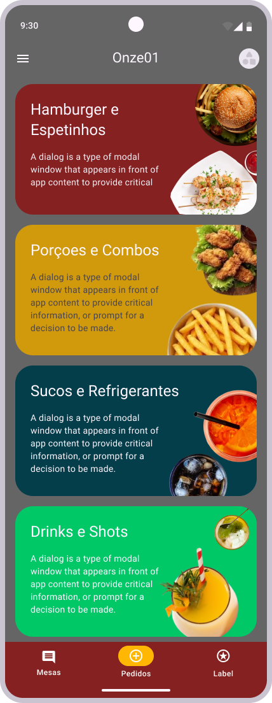
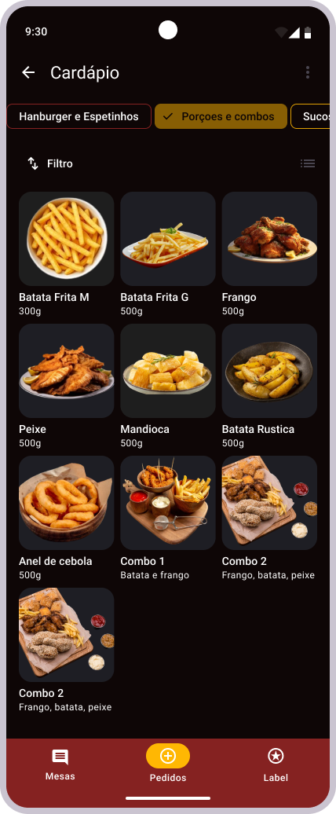
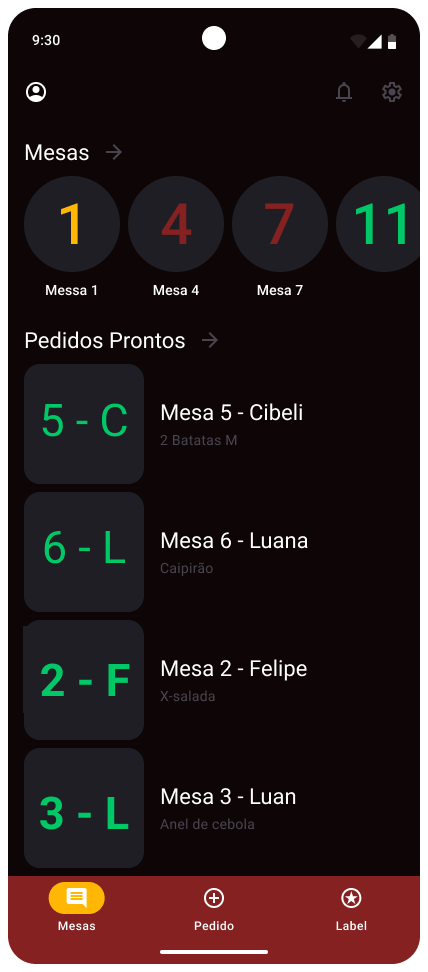
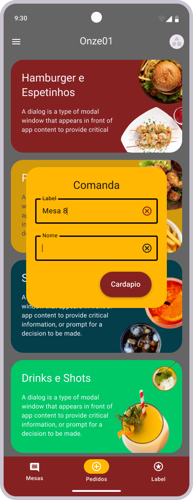

# Tarefas de Desenvolvimento Front-end

[Voltar](../DOCUMENTACAO.md)
 
## Objetivo desta fase

Entregar um MVP navegável das telas de **Home, Cardápio, Mesas e Pedidos**, usando dados mockados localmente e sem comunicação com o back-end.

Este backlog parte do ponto definido após a Seção 14 do [Plano de Desenvolvimento Front-end](./Plano_Desenvolvimento.md). O escopo desta etapa não inclui integração com API, autenticação, telas de login, controle de acesso por cargo ou criação de áreas restritas. Regras operacionais relevantes serão simuladas no front-end com dados mockados.

## Referências obrigatórias

- Plano técnico: [Plano_Desenvolvimento.md](./Plano_Desenvolvimento.md)
- Protótipo geral: [Prototipagem/App Restaurante.png](../../Prototipagem/App%20Restaurante.png)
- Requisitos funcionais: [RF001-RF025](./Requisitos_Funcionais.md)
- Regras de negócio: [RN001-RN016](./Regras_Negocio.md)
- Protótipo textual das telas: [Prototipagem/telas.md](../../Prototipagem/telas.md)

## Convenções para todas as tarefas

- Usar a estrutura e os componentes base já existentes, sem reconstruir a fundação do projeto.
- Usar componentes do design system antes de criar componentes novos.
- Nenhuma tela desta fase deve chamar API ou depender do back-end.
- Ler e alterar dados por uma camada local de mocks compartilhada; não duplicar fixtures dentro de páginas.
- Estados de loading, vazio, erro e desabilitado devem ser representados quando fizerem parte do fluxo, sem simular falhas de rede como se houvesse API.
- O layout deve ser validado a partir de 360 px até desktop.
- Não implementar login, guards, perfis, permissões ou bloqueios por cargo.
- Aplicar no front-end as regras operacionais explicitadas nas tarefas, usando os mocks como fonte local dos dados.
- Testes unitários e de integração são parte da conclusão. Não criar apenas uma implementação visual.

## Mapa de tarefas por épico

| Tarefa | Épico |
|---|---|
| 1 — Dados mockados compartilhados | EF-01 — Fundação de Dados Mockados e Estado Local |
| 2 — Navegação da Home | EF-02 — Navegação, Home e Cardápio |
| 3 — Cardápio por categoria | EF-02 — Navegação, Home e Cardápio |
| 4 — Mapa de mesas | EF-03 — Operação de Salão: Mesas e Comandas |
| 5 — Abertura de comanda | EF-03 — Operação de Salão: Mesas e Comandas |
| 6 — Visão da mesa | EF-03 — Operação de Salão: Mesas e Comandas |
| 7 — Montagem e edição de pedido | EF-04 — Ciclo Completo dos Pedidos |
| 8 — Status e impressão | EF-04 — Ciclo Completo dos Pedidos |
| 9 — Cancelamento com justificativa | EF-04 — Ciclo Completo dos Pedidos |
| 10 — Visão de pedidos ativos | EF-04 — Ciclo Completo dos Pedidos |
| 11 — Fechamento da comanda | EF-05 — Fechamento da Comanda e Sincronização da Mesa |
| 12 — Testes, acessibilidade e validação visual | EF-06 — Qualidade, Acessibilidade e Validação Visual |

---

## Tarefa 1: Criar dados mockados compartilhados para todas as telas

**Épico:** EF-01 — Fundação de Dados Mockados e Estado Local

**Objetivo**

Fornecer dados de demonstração consistentes e operações locais simples para Home, Cardápio, Mesas e Pedidos.

**O que deve ser feito**

Criar um conjunto único de fixtures e uma camada mockada local para categorias, produtos, estoque, mesas, clientes de demonstração, comandas, pedidos e formas de pagamento. Os dados devem alimentar todas as telas e permitir testar os fluxos sem servidor.

**Por que deve ser feito**

Uma fonte compartilhada mantém as telas sincronizadas e permite desenvolver e demonstrar o MVP enquanto o back-end não está pronto. Dados variados também tornam visíveis os estados livres, ocupados, esgotados, vazios e em andamento.

**Como deve ser feito**

1. Criar fixtures tipadas na pasta local de mocks adotada pelo projeto, agrupadas por entidade e sem espalhar dados de exemplo pelos componentes.
2. Incluir categorias que aparecem na Home e Cardápio; produtos com imagem, descrição, preço, categoria, unidade e quantidades de estoque disponíveis, baixas e zeradas.
3. Incluir mesas livres, ocupadas e pedindo a conta; pelo menos uma mesa deve ter múltiplas comandas ativas.
4. Incluir comandas com clientes identificados e `Consumidor Final`, além de pedidos nos estados `Em Andamento`, `Pendente` e `Entregue`.
5. Incluir pedidos com mais de um item, observações, valores e pelo menos um caso útil para cancelamento e fechamento.
6. Criar funções locais simples para listar e alterar esses dados: abrir comanda, criar/editar pedido, mudar status, cancelar item/pedido e fechar comanda.
7. Calcular totais e contagem de comandas a partir dos dados locais; manter uma única fonte de cálculo.
8. Garantir que mudanças em uma tela apareçam nas demais durante a sessão. Usar o mecanismo de estado já conhecido no projeto, sem introduzir bibliotecas ou arquitetura avançada.
9. Disponibilizar uma ação simples de restaurar os dados de demonstração ao estado inicial.
10. Não criar cliente HTTP, endpoint fictício, login, usuários por cargo nem simulação de autenticação.

**Requisitos relacionados**

- RF007, RF008, RF013, RF014, RF015, RF016, RF017, RF018 e RF023.
- RN003, RN004, RN005, RN006, RN007, RN008, RN009, RN010 e RN011.
- NFR003 e NFR004.

**Critérios de aceite**

- Todas as telas usam a mesma fonte de dados mockados.
- Fixtures cobrem categorias, disponibilidade de estoque, estados de mesa e de pedido, comandas múltiplas, clientes, cancelamento e fechamento.
- Ações locais atualizam os dados compartilhados e mantêm contagens e totais coerentes.
- Restaurar dados de demonstração retorna o MVP ao estado inicial.
- Não há chamadas HTTP, dependência do back-end, autenticação ou usuários/perfis no escopo.
- Desenvolvedores conseguem identificar e editar os dados de demonstração em um local documentado no código.

**Dependências**

- Nenhuma.

**Pastas sugeridas**

- `src/data/mock/` ou pasta equivalente já adotada; fixtures e operações locais simples.

---

## Tarefa 2: Construir a navegação da Home

**Épico:** EF-02 — Navegação, Home e Cardápio

**Objetivo**

Entregar a tela inicial com categorias do cardápio e navegação principal igual ao protótipo.

**O que deve ser feito**

Criar a página Home baseada no protótipo mobile. Exibir categorias em cards coloridos, indicador visual de estoque ou disponibilidade onde necessário e barra inferior de navegação para Mesas, Pedidos e outra ação definida pelo projeto.

**Por que deve ser feito**

A Home é o ponto de entrada definido pelo protótipo e precisa oferecer acesso rápido às áreas operacionais sem adicionar etapas ao atendimento.

**Como deve ser feito**

1. Criar `HomePage` na feature correspondente à arquitetura existente.
2. Implementar rotação responsiva dos cards entre 360 px e desktop.
3. Renderizar categorias da camada de dados mockados criada na tarefa 1.
4. Usar links acessíveis e estados visíveis de foco, ativo e desabilitado.
5. Implementar a barra inferior fixa com os itens do protótipo: Mesas, Pedidos e ação central.
6. Ao tocar em uma categoria, navegar para o Cardápio aplicando o filtro da categoria.
7. Ao tocar em Mesas, navegar para `/mesas`.
8. Ao tocar em Pedidos, navegar para a visão de pedidos ativos.
9. Não duplicar a navegação já fornecida pelo layout do Dashboard.

**Referência visual**

**Requisitos relacionados**

- RF013 e RF023.
- RN011.
- NFR003 e NFR004.

**Critérios de aceite**

- A Home apresenta o título ou identificação do restaurante conforme protótipo.
- Categorias são lidas da camada mockada e não digitadas diretamente no componente.
- Cada categoria abre o Cardápio com filtro correspondente.
- Os cards exibem imagem, título e estado visual correto.
- A barra inferior permite navegar para Mesas e Pedidos.
- Em 360 px não ocorre overflow horizontal.
- Clique, teclado e foco são suportados.
- Categoria vazia é apresentada sem erro de rede artificial.

**Dependências**

- 1.

**Pastas sugeridas**

- `src/presentation/features/dashboard/`
- `src/presentation/features/cardapio/`
- `src/presentation/components/navigation/`

---

## Tarefa 3: Implementar o Cardápio por categoria

**Épico:** EF-02 — Navegação, Home e Cardápio

**Objetivo**

Entregar o catálogo funcional usado pelo garçom para montar pedidos.

**O que deve ser feito**

Criar a tela de Cardápio com abas horizontais de categorias, busca, cards de produtos e indicação clara de disponibilidade por estoque.

**Por que deve ser feito**

O garçom precisa localizar rapidamente o item correto e deve saber antes da escolha se o produto está disponível.

**Como deve ser feito**

1. Criar `CardapioPage` com estado da categoria e termo de busca refletidos na URL.
2. Ler categorias disponíveis dos dados mockados e organizar a primeira como seleção padrão.
3. Renderizar abas que podem navegar por teclado e manter rolagem no mobile.
4. Renderizar produto com imagem, nome, quantidade ou peso exibido, preço e estoque.
5. Mostrar estoque com o formato do protótipo:
   - disponível: `[42 un]`;
   - esgotado: `[0 un - Esgotado]`.
6. Exibir itens abaixo do mínimo como baixa disponibilidade quando esse dado existir no mock.
7. Ocultar produtos desativados ou sem disponibilidade, exceto o item esgotado de demonstração que deve permanecer visível e desabilitado conforme o protótipo.
8. Desabilitar completamente o botão de adicionar para itens esgotados.
9. Exibir EmptyState quando a busca ou categoria não tiver produtos.
10. Ao adicionar o item, abrir o fluxo do pedido associado à comanda selecionada nos dados locais.

**Referência visual**

**Requisitos relacionados**

- RF013, RF015 e RF023.
- RN005, RN010 e RN011.
- NFR003 e NFR004.

**Critérios de aceite**

- Categorias e produtos vêm da fonte mockada compartilhada.
- Busca filtra nome e campos disponíveis nos dados mockados.
- O produto esgotado aparece cinza e seu botão fica desabilitado.
- Itens sem disponibilidade ficam ocultos, exceto o item esgotado de demonstração, visível em cinza e sem ação de adicionar.
- Quantidade disponível é atualizada localmente após as ações de pedido e entrega simuladas.
- Selecionar uma categoria da Home abre o filtro correto.
- Filtros funcionam ao recarregar a URL.
- Mobile permite navegação sem esconder o botão principal.

**Dependências**

- 1 e 2.

**Pastas sugeridas**

- `src/presentation/features/cardapio/`
- `src/presentation/features/pedidos/`

---

## Tarefa 4: Implementar o mapa de mesas

**Épico:** EF-03 — Operação de Salão: Mesas e Comandas

**Objetivo**

Criar uma visão rápida de todas as mesas, status e quantidade de comandas ativas.

**O que deve ser feito**

Criar o mapa em grid ou lista responsiva. Cada mesa deve mostrar identificação, área quando disponível, status e quantidade de comandas abertas.

**Por que deve ser feito**

O garçom precisa identificar em poucos toques quais mesas estão livres, ocupadas ou pedindo a conta.

**Como deve ser feito**

1. Criar `MesasPage` e ler a lista de mesas ativas nos dados mockados.
2. Implementar os status visuais:
   - Livre: verde;
   - Ocupada: azul;
   - Conta: laranja.
3. Exibir o identificador da mesa e a contagem de comandas ativas.
4. Permitir filtro por área e busca por identificação quando disponível.
5. Ordenar mesas por identificação de forma previsível.
6. Ao tocar em mesa livre, permitir abrir comanda ou visualizar a mesa conforme fluxo definido.
7. Ao tocar em mesa ocupada ou pedindo conta, abrir a tela de comandas da mesa.
8. Não permitir editar ou excluir mesas nesta fase, pois isso pertence a RF007.
9. Atualizar o estado compartilhado local após abrir ou fechar uma comanda.

**Referência visual**

**Requisitos relacionados**

- RF007, RF014 e RF023.
- RN003.
- NFR003 e NFR004.

**Critérios de aceite**

- Todas as mesas ativas são listadas.
- Mesa com pelo menos uma comanda não finalizada é exibida como Ocupada.
- Mesa é exibida como Livre somente sem comandas abertas.
- Contagem de comandas ativa é correta.
- Status visual usa as cores do design system.
- Busca e filtro não alteram dados da mesa.
- A tela suporta 360 px sem quebra horizontal.
- Estado vazio e validações locais são tratados; não há simulação de falha de rede.

**Dependências**

- 1.

**Pastas sugeridas**

- `src/presentation/features/mesas/`
- `src/presentation/features/comandas/`

---

## Tarefa 5: Implementar abertura de comanda e seleção de cliente

**Épico:** EF-03 — Operação de Salão: Mesas e Comandas

**Objetivo**

Permitir abrir uma ou várias comandas para uma mesa.

**O que deve ser feito**

Criar o modal ou página de abertura de comanda. Permitir vincular mesa, buscar cliente existente e selecionar `Consumidor Final`.

**Por que deve ser feito**

A mesa pode atender grupos separados e cada comanda precisa de um responsável ou identificação própria.

**Como deve ser feito**

1. Abrir o fluxo por toque em uma mesa livre ou ocupada.
2. Pré-preencher a mesa selecionada e impedir alteração indevida.
3. Oferecer busca local de cliente por nome, CPF ou telefone nos dados mockados.
4. Permitir cadastrar ou selecionar `Consumidor Final`.
5. Ao cadastrar consumidor, exigir nome e telefone; tornar CPF opcional e validar formato.
6. Impedir CPF duplicado comparando com os clientes mockados.
7. Criar comanda com status inicial `Aberta`.
8. Após a criação local, navegar diretamente para a comanda criada ou para a visão da mesa.
9. Atualizar o estado compartilhado local para refletir a nova comanda nas telas de mesas e pedidos.
10. Exibir confirmação ou toast com número da comanda criada.

**Referência visual**

**Requisitos relacionados**

- RF008 e RF014.
- RN001, RN003 e RN004.
- NFR004.

**Critérios de aceite**

- A comanda pode ser aberta em mesa livre ou ocupada.
- Mesa inexistente ou inativa nos dados mockados não é aceita.
- Cliente existente pode ser selecionado por busca.
- `Consumidor Final` funciona sem dados pessoais.
- Nome e telefone são obrigatórios em novo cliente.
- CPF inválido ou duplicado é bloqueado conforme RN001 e RN004.
- Dados digitados permanecem após erro de validação local.
- Mesa muda para Ocupada após uma comanda criada.
- Fluxo conclui a abertura em até três toques a partir da tela inicial.

**Dependências**

- 1 e 4.

**Pastas sugeridas**

- `src/presentation/features/comandas/`
- `src/presentation/features/clientes/`

---

## Tarefa 6: Implementar visão da mesa e divisão de comandas

**Épico:** EF-03 — Operação de Salão: Mesas e Comandas

**Objetivo**

Mostrar todas as comandas ativas da mesa e permitir escolher onde lançar ou consultar pedidos.

**O que deve ser feito**

Criar uma tela com lista de comandas da mesa selecionada, dados do responsável e resumo dos pedidos e valores.

**Por que deve ser feito**

Uma mesa pode representar várias contas separadas. A UI precisa impedir lançamentos na comanda errada.

**Como deve ser feito**

1. Exibir identificação da mesa e quantidade de comandas abertas.
2. Listar uma comanda por cliente ou número.
3. Mostrar pedidos agrupados por status dentro de cada comanda.
4. Exibir valor total calculado a partir dos pedidos e itens mockados.
5. Disponibilizar botão de adicionar novo pedido em cada comanda.
6. Disponibilizar ação de nova comanda na própria mesa.
7. Permitir selecionar uma comanda e seguir para montagem do pedido.
8. Manter as ações disponíveis para o MVP, sem ocultar controles por cargo.
9. Exibir EmptyState quando não houver comandas.

**Requisitos relacionados**

- RF014, RF015 e RF016.
- RN003 e RN005.
- NFR003 e NFR004.

**Critérios de aceite**

- Todas as comandas não finalizadas da mesa são listadas.
- Comandas finalizadas não podem ser editadas nesta tela.
- Valor total é exibido sem permitir edição manual.
- Selecionar comanda leva ao pedido correto.
- O botão de nova comanda cria uma comanda adicional sem modificar as existentes.
- Estado vazio e validações locais estão implementados; não há estados de carregamento ou falha de rede.
- Navegação por teclado e foco estão corretos.

**Dependências**

- 4 e 5.

**Pastas sugeridas**

- `src/presentation/features/mesas/`
- `src/presentation/features/comandas/`

---

## Tarefa 7: Criar montagem e edição de pedido

**Épico:** EF-04 — Ciclo Completo dos Pedidos

**Objetivo**

Permitir selecionar itens do Cardápio, definir quantidade e montar um pedido em status `Em Andamento`.

**O que deve ser feito**

Criar a tela ou fluxo modal de pedido vinculado à comanda ativa. Permitir adicionar itens, alterar quantidade, remover itens, adicionar observação e recalcular o total.

**Por que deve ser feito**

Esta é a operação central do atendimento e deve evitar cálculo incorreto, itens esgotados e envio acidental.

**Como deve ser feito**

1. Criar pedido local em `Em Andamento` ao iniciar a montagem.
2. Ler o Cardápio por categoria e estoque dos dados mockados.
3. Impedir adicionar produto desativado ou esgotado.
4. Permitir definir quantidade mínima 1 e bloquear quantidade maior que estoque disponível.
5. Permitir remover item enquanto o pedido estiver `Em Andamento`.
6. Permitir observação por item ou por pedido usando o campo escolhido nos dados mockados.
7. Não criar campo editável para `valor_total`.
8. Calcular o total a partir dos preços e quantidades dos itens mockados.
9. Exibir identificação da mesa e da comanda em todos os estados da montagem.
10. Bloquear confirmação ou envio de pedido vazio.
11. Habilitar envio apenas para pedidos com itens válidos.

**Requisitos relacionados**

- RF015 e RF023.
- RN005, RN006 e RN010.
- NFR003 e NFR004.

**Critérios de aceite**

- Pedido novo inicia em `Em Andamento`.
- Quantidade inválida, estoque insuficiente e item vazio são bloqueados.
- Item esgotado não pode ser selecionado.
- Remoção recalcula subtotal e total.
- Observações são preservadas na submissão.
- O total exibido corresponde à soma dos itens e quantidades do pedido local.
- Pedido vazio não é enviado.
- Pedido em `Pendente` ou `Entregue` não permite edição.

**Dependências**

- 3 e 6.

**Pastas sugeridas**

- `src/presentation/features/pedidos/`
- `src/presentation/features/cardapio/`

---

## Tarefa 8: Implementar fluxo de status e impressão

**Épico:** EF-04 — Ciclo Completo dos Pedidos

**Objetivo**

Permitir transições de pedido entre `Em Andamento`, `Pendente` e `Entregue` sem violações de regra.

**O que deve ser feito**

Adicionar ações de confirmação e entrega para pedidos, validando status atual e disparando a impressão apenas na transição correta.

**Por que deve ser feito**

O status controla o congelamento dos itens, a baixa de estoque e a impressão automática. Uma ação fora da sequência pode gerar pedido fantasma ou estoque incorreto.

**Como deve ser feito**

1. Mostrar apenas ações compatíveis com o status atual.
2. Permitir `Em Andamento` → `Pendente` uma única vez.
3. Permitir `Pendente` → `Entregue` após confirmação.
4. Não permitir retorno de status anterior.
5. Ao confirmar, atualizar o pedido nos dados mockados e impedir ações repetidas durante a atualização local.
6. Simular o resultado da impressão apenas na interface, mantendo o pedido `Pendente` e oferecendo ação de reimpressão de demonstração.
7. No fluxo de entrega, atualizar o estoque e o total da comanda nos dados locais compartilhados.
8. Bloquear entrega local se o estoque mockado for insuficiente.
9. Mostrar confirmação clara antes de mudar status.
10. Não chamar impressão ao criar ou editar pedido em `Em Andamento`.

**Requisitos relacionados**

- RF016 e RF025.
- RN006, RN007 e RN010.
- RN012.
- NFR006.

**Critérios de aceite**

- As únicas transições exibidas são as permitidas.
- Impressão dispara somente em `Em Andamento` → `Pendente`.
- Resultado de impressão simulado não reverte o pedido para `Em Andamento`.
- Pedido `Pendente` não permite edição de itens.
- Pedido `Entregue` não permite edição ou remoção.
- A baixa de estoque simulada ocorre localmente na transição para `Entregue`.
- Estoque insuficiente impede entrega e mostra item ou quantidade insuficiente.
- Ações de repetição ficam bloqueadas durante a atualização local.

**Dependências**

- 7.

**Pastas sugeridas**

- `src/presentation/features/pedidos/`
- `src/data/mock/`

---

## Tarefa 9: Implementar cancelamento com justificativa

**Épico:** EF-04 — Ciclo Completo dos Pedidos

**Objetivo**

Permitir cancelar item ou pedido inteiro apenas em status elegíveis e com justificativa.

**O que deve ser feito**

Criar modal de cancelamento com opções e campo obrigatório de justificativa, atualização do total e mensagem clara de bloqueio para pedidos entregues.

**Por que deve ser feito**

Cancelamento altera o total do pedido. A justificativa deve ser mantida nos dados mockados da sessão; auditoria persistente fica fora do MVP.

**Como deve ser feito**

1. Permitir cancelamento de item ou pedido apenas em status diferente de `Entregue`.
2. Permitir cancelamento de pedido inteiro com justificativa.
3. Exibir lista curta de justificativas padrão e permitir informar outra justificativa.
4. Exigir justificativa antes de habilitar confirmação.
5. Mostrar impacto no valor da comanda antes da confirmação.
6. Bloquear cancelamento de pedido entregue com mensagem `Pedido já concluído`.
7. Aplicar cancelamento aos dados mockados após confirmação e manter a justificativa associada ao item ou pedido cancelado.
8. Atualizar valor da comanda e status do pedido ou item no estado compartilhado.
9. Confirmar que as telas de pedido, comanda e mesa refletem a alteração.

**Requisitos relacionados**

- RF018.
- RN007 e RN008.

**Critérios de aceite**

- Cancelamento sem justificativa é bloqueado.
- Item ou pedido entregue não pode ser cancelado.
- O valor exibido após confirmação é recalculado a partir dos dados locais.
- Justificativa fica associada ao registro cancelado enquanto a sessão de demonstração estiver ativa.
- Modal impede dupla submissão.
- A UI mostra erro claro quando a validação local impede o cancelamento.
- Dados cancelados são atualizados em todas as telas abertas.

**Dependências**

- 7.

**Pastas sugeridas**

- `src/presentation/features/pedidos/`
- `src/presentation/components/feedback/`

---

## Tarefa 10: Implementar visão de pedidos ativos

**Épico:** EF-04 — Ciclo Completo dos Pedidos

**Objetivo**

Entregar uma lista funcional de pedidos por mesa e status para acompanhar o atendimento.

**O que deve ser feito**

Criar uma página ou aba de Pedidos com filtros por status e mesa, resumo de itens e ações rápidas permitidas.

**Por que deve ser feito**

O protótipo mostra pedidos prontos agrupados por mesa. O garçom precisa revisar Pendentes e Entregues sem entrar mesa por mesa.

**Como deve ser feito**

1. Criar `PedidosPage` com filtros por Mesa e status.
2. Exibir contagem ou badges para `Em Andamento`, `Pendente` e `Entregue`.
3. Agrupar registros por mesa.
4. Exibir número da comanda, itens, quantidade e horário quando disponível.
5. Permitir busca por mesa ou comanda.
6. Disponibilizar ações conforme o status do pedido; não aplicar restrições por cargo.
7. Navegar para detalhe da comanda ao selecionar pedido.
8. Aplicar filtros na URL.
9. Atualizar a lista após mudanças de status ou cancelamento.
10. Ler e atualizar os registros pela fonte mockada compartilhada.

**Referência visual**

**Requisitos relacionados**

- RF016 e RF023.
- RN006 e RN007.
- NFR003 e NFR004.

**Critérios de aceite**

- Pedidos são listados por status e mesa.
- Filtros funcionam individualmente e em combinação.
- Pedido correto abre a comanda correta.
- Ações incompatíveis com o status não aparecem.
- Estado vazio existe para cada filtro.
- Atualizações de status refletem a lista sem reload manual.
- Layout não quebra em 360 px.

**Dependências**

- 8 e 9.

**Pastas sugeridas**

- `src/presentation/features/pedidos/`

---

## Tarefa 11: Simular fechamento da comanda

**Épico:** EF-05 — Fechamento da Comanda e Sincronização da Mesa

**Objetivo**

Permitir demonstrar o fechamento de uma comanda usando somente os dados mockados.

**O que deve ser feito**

Exibir total consolidado e bloquear fechamento enquanto existir pedido em status diferente de `Entregue`. Permitir selecionar forma de pagamento mockada e concluir a operação local.

**Por que deve ser feito**

O fluxo demonstra a regra operacional de fechamento sem API ou transação no servidor. As alterações precisam permanecer coerentes entre as telas durante a sessão.

**Como deve ser feito**

1. Exibir resumo por pedido e total consolidado.
2. Ler os pedidos vinculados nos dados mockados antes de habilitar fechamento.
3. Bloquear fechamento se houver pedido `Em Andamento` ou `Pendente`.
4. Mostrar a regra bloqueadora e o pedido que impede o fechamento.
5. Permitir selecionar uma forma de pagamento da lista mockada.
6. Confirmar antes de aplicar a ação local.
7. Aplicar o fechamento localmente como uma única ação de interface.
8. Atualizar estado da comanda, mesa e pedidos nas telas que usam os mocks.
9. Em caso de validação local inválida, manter os dados e mostrar a razão do bloqueio.

**Requisitos relacionados**

- RF017.
- RN009.

**Critérios de aceite**

- Fechamento fica bloqueado com pedido não entregue.
- Mensagem indica exatamente o que impede o fechamento.
- Valor exibido não é editável pelo usuário.
- Forma de pagamento mockada é obrigatória para confirmar o fechamento.
- Após sucesso, comanda fica finalizada.
- Última comanda finalizada libera a mesa para `Livre`.
- Validação local impede fechamento parcial ou de comanda não elegível.

**Dependências**

- 6, 8 e 9.

**Pastas sugeridas**

- `src/presentation/features/comandas/`
- `src/data/mock/`

---

## Tarefa 12: Adicionar testes, acessibilidade e validação visual

**Épico:** EF-06 — Qualidade, Acessibilidade e Validação Visual

**Objetivo**

Comprovar que Home, Cardápio, Mesas e Pedidos funcionam de ponta a ponta e permanecem utilizáveis em mobile.

**O que deve ser feito**

Criar testes unitários, de integração e end-to-end dos fluxos principais usando os dados mockados. Validar contraste, foco, touch targets e responsividade contra os protótipos.

**Por que deve ser feito**

As regras operacionais dependem de estados encadeados. Testes devem proteger transições, valores e estoque simulados contra regressões.

**Como deve ser feito**

1. Reutilizar fixtures compartilhadas da tarefa 1 para mesas, comandas, produtos, clientes e pedidos.
2. Testar navegação da Home para categoria, Mesa e Pedido.
3. Testar abertura de comanda em mesa livre e ocupada.
4. Testar múltiplas comandas na mesma mesa.
5. Testar montagem com item disponível e esgotado.
6. Testar total automático e bloqueio de edição após entrega.
7. Testar todas as transições do RN006.
8. Testar cancelamento com justificativa e bloqueio de pedido entregue.
9. Testar fechamento bloqueado e fechado com sucesso.
10. Confirmar que ações não são escondidas nem bloqueadas por cargo nesta fase.
11. Executar testes automatizados em 360 px, tablet e desktop.
12. Validar estados vazios, desabilitados e mensagens de validação local; não simular loading ou erro de rede.
13. Registrar comparação visual dos protótipos no PR.

**Requisitos relacionados**

- RF013 a RF018 e RF023.
- RN003 a RN011.
- NFR003, NFR004 e NFR006.

**Critérios de aceite**

- Fluxo completo Home → Mesa → Comanda → Pedido → Entrega está coberto.
- Fluxo Cardápio → item disponível → pedido em andamento está coberto.
- Item esgotado não pode ser adicionado.
- Todas as transições inválidas são bloqueadas ou protegidas por teste.
- Cancelamento exige justificativa.
- Fechamento exige todos os pedidos entregues.
- Testes passam em CI.
- Nenhum elemento essencial fica abaixo de 44 px de área tocável.
- Navegação por teclado funciona nas ações críticas.
- Não existe overflow horizontal em 360 px.
- Build e lint passam sem warnings bloqueantes.

**Dependências**

- Todas as tarefas 2 a 11.

**Pastas sugeridas**

- `src/**/*.test.ts`
- `src/**/*.test.tsx`
- `e2e/` ou pasta equivalente já configurada pelo projeto

---

## Divisão do trabalho entre duas equipes

Organize duas equipes com 4–5 pessoas cada. A divisão abaixo mantém as dependências explícitas e permite trabalhar em paralelo sem duplicar componentes ou dados.

### Equipe A — Home, Cardápio e fluxo do pedido

**Responsabilidades**

- Ser responsável pela implementação e manutenção da camada compartilhada de mocks da tarefa 1.
- Executar as tarefas 2 e 3: Home e Cardápio.
- Executar a tarefa 7: montagem e edição do pedido.
- Executar as tarefas 8 e 10: status, impressão simulada e lista de pedidos.
- Participar da integração e dos testes finais da tarefa 12.

**Divisão interna sugerida**

- 1 pessoa coordena integração, PRs e interface da camada mockada.
- 2 pessoas desenvolvem Home e Cardápio.
- 1–2 pessoas desenvolvem o fluxo do pedido, status e testes da feature.
- Com 4 pessoas, alternar a responsabilidade de testes entre os desenvolvedores.

### Equipe B — Mesas, comandas e fechamento

**Responsabilidades**

- Revisar os tipos e as funções mockadas da tarefa 1 antes de iniciar as telas.
- Executar as tarefas 4, 5 e 6: mapa de mesas, abertura de comanda e visão da mesa.
- Executar a tarefa 9: cancelamento com justificativa.
- Executar a tarefa 11: fechamento simulado da comanda.
- Participar da integração e dos testes finais da tarefa 12.

**Divisão interna sugerida**

- 1 pessoa coordena integração com a Equipe A e revisa PRs.
- 2 pessoas desenvolvem mesas e comandas.
- 1 pessoa desenvolve cancelamento e fechamento.
- A 5ª pessoa, quando houver, foca nos testes de fluxo e validação visual.

### Etapas de execução e paralelismo

| Etapa | Equipe A | Equipe B | Ponto de integração |
|---|---|---|---|
| 1. Base mockada | Implementa a tarefa 1 e publica cedo os tipos e funções locais acordados. | Revisa tipos, dados de demonstração e funções necessárias; mapeia componentes e navegação das telas de salão. | As equipes aprovam um único modelo de Mesa, Comanda, Pedido, Produto e Categoria. |
| 2. Telas em paralelo | Faz 2; depois, 3. | Faz 4; depois, 5 e 6. | As equipes usam a mesma fonte mockada. A Equipe B pode iniciar 4 assim que os tipos da tarefa 1 estiverem publicados. |
| 3. Montagem do pedido | Faz 7 após 3 e 6. | Revisa integração de mesa/comanda e prepara a interface de cancelamento com o modelo já acordado. | Confirmar que seleção de comanda leva ao pedido correto e que os itens vêm do Cardápio. |
| 4. Ações do pedido em paralelo | Faz 8 após 7. | Faz 9 após 7, em paralelo com 8. | Congelar interfaces das operações locais de status e cancelamento antes de integrar. |
| 5. Listas e fechamento | Faz 10 após 8 e 9. | Faz 11 após 6, 8 e 9. | Validar que as duas telas mostram os mesmos totais, status e disponibilidade de mesas. |
| 6. Validação final | Executa 12 junto com a Equipe B. | Executa 12 junto com a Equipe A. | Testar os fluxos completos e corrigir problemas em conjunto. |

### Regras de colaboração

- A tarefa 1 tem uma única equipe responsável: a Equipe A. A Equipe B revisa e consome a interface, sem criar fixtures ou operações paralelas.
- A Equipe A mantém a camada `src/data/mock/`. A Equipe B usa as funções acordadas e solicita mudanças por PR, evitando editar os mesmos arquivos simultaneamente.
- Cada equipe deve manter suas páginas e componentes nas respectivas pastas de feature. Compartilhar componentes somente após acordo entre os responsáveis.
- Usar PRs pequenos por tarefa e integrar frequentemente. Não aguardar o fim de todas as telas para juntar as branches.
- Se um mock necessário estiver faltando, as equipes combinam a alteração do mock antes de criar dados locais dentro de uma página.
- Não iniciar 7 antes das telas de Cardápio e visão de comanda estarem integradas. Não iniciar a validação ponta a ponta de 12 antes de todas as features estarem disponíveis.

## Ordem recomendada de execução

1. 1: dados mockados compartilhados; Equipe B revisa os tipos e operações.
2. Em paralelo: Equipe A faz 2 e depois 3; Equipe B faz 4, 5 e depois 6.
3. 7: montagem do pedido após Cardápio e visão de comanda estarem integrados.
4. Em paralelo: Equipe A faz 8; Equipe B faz 9.
5. Em paralelo: Equipe A faz 10; Equipe B faz 11.
6. 12: testes ponta a ponta e validação visual com as duas equipes.

## Definition of Done da fase

A fase está concluída somente quando:

- Todas as telas funcionam exclusivamente com dados mockados compartilhados.
- Não existe ação baseada apenas em design sem regra de negócio correspondente.
- Status, totais e estoque são atualizados pelas operações locais mockadas.
- Login, autenticação, autorização por cargo e chamadas ao back-end não fazem parte do MVP.
- Os estados vazio e desabilitado estão implementados; loading e erro são tratados quando pertinentes ao fluxo local.
- As telas correspondem visualmente aos protótipos em mobile e desktop.
- Build, lint, typecheck, testes unitários e testes de integração passam.
- O fluxo end-to-end principal foi demonstrado ao Product Owner.
