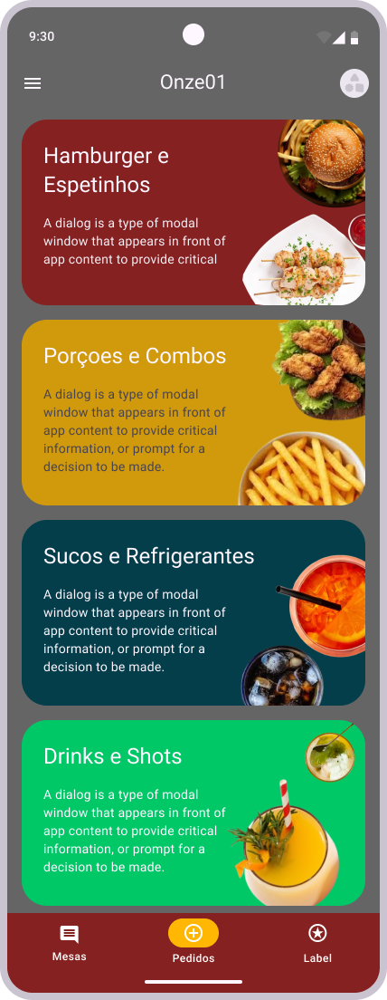
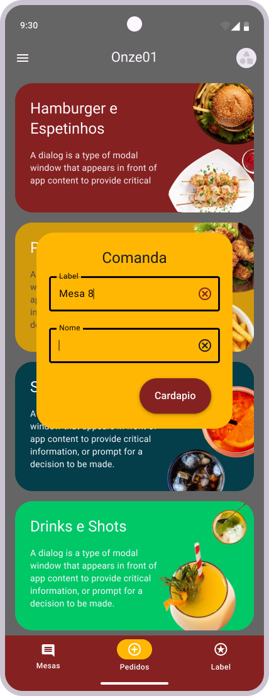
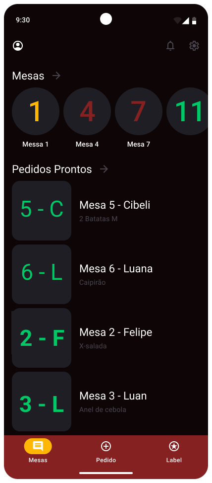
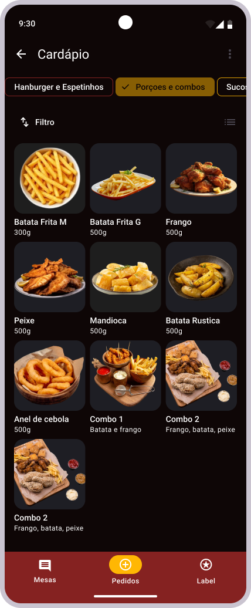

# App Restaurante - ADA EJ

Aplicação web de gestão para restaurantes e bares da ADA EJ.

Este repositório contém o front-end em desenvolvimento. O objetivo é reunir mesas, comandas, pedidos, produtos, estoque e outras operações do restaurante em uma interface acessível e responsiva.

## Documentação completa

> [Abrir documentação completa](./Documentação/Documentação/DOCUMENTACAO.md)

Na aplicação, use também a rota [`/documentacao`](http://localhost:5173/documentacao).

## Estado atual do projeto

| Área | Estado | Observação |
|---|---|---|
| Prototipagem | Em andamento | Layouts gerais, mapa de mesas e telas móveis já foram definidos |
| Design system | Implementado como base | Paleta, tipografia, componentes, espaçamento e sombras estão configurados |
| Estrutura React | Implementada | Projeto criado com Vite, React, TypeScript e Tailwind CSS |
| Login | Protótipo implementado | Formulário com validação existe; fluxo com API ainda depende do back-end |
| Autenticação | Protótipo implementado | Estado persistido com Zustand e envio de token no Axios |
| Roteamento | Base implementada | Páginas de login e design system; proteção de rota preparada |
| Dados mockados | Base implementada | Fixtures e operações locais compartilhadas em `src/data/mock/` |
| Mapa de mesas | Não implementado | Existe apenas no protótipo |
| Comandas e pedidos | Não implementados | Requisitos e protótipos estão documentados |
| Estoque | Não implementado | Identidade visual e estados estão definidos |
| Testes automatizados | Ainda não configurados no projeto | Vitest e Testing Library estão instalados, mas não há script nem testes |

## Protótipos

### Tela principal


### Telas principais no Figma





### Exemplos responsivos





Os protótipos conceituam:

- mapa de mesas com status livre, ocupada, pedindo a conta e reservada;
- divisão de mesas em comandas;
- lançamento de pedidos por categorias;
- validação visual de estoque;
- estados bloqueados para itens esgotados;
- tema escuro com contraste para ambientes internos.

## Começar a usar

### Requisitos

- Windows, macOS ou Linux
- Node.js versão 18 ou superior
- npm
- Git

No VS Code, abra a pasta do projeto e use o terminal integrado. Em Windows, o atalho é `Ctrl + '`.

### Primeira execução

```bash
git clone https://github.com/adaejbr/app-template-restaurante-fed.git
cd app-template-restaurante-fed
npm install
npm run dev
```

Abra o endereço exibido no terminal. Normalmente, é `http://localhost:5173`.

### Executar uma versão já disponível

```bash
npm install
npm run dev
```

Não é necessário executar `npm install` novamente enquanto as dependências não forem alteradas.

## Comandos do projeto

| Comando | Para que serve |
|---|---|
| `npm run dev` | Inicia o servidor local e atualiza a tela ao salvar arquivos |
| `npm run build` | Verifica o TypeScript e gera os arquivos de produção |
| `npm run preview` | Exibe localmente a versão gerada pelo build |
| `npm run lint` | Procura problemas no código com Oxlint |
| `npm run build && npm run preview` | Valida a compilação e abre uma prévia da versão final |

### Testes

Vitest e Testing Library já estão instalados. Como ainda não existe script `test` nem arquivos de teste no projeto, execute testes adicionados pelo terminal com:

```bash
npx vitest run
```

Para acompanhar testes enquanto desenvolve:

```bash
npx vitest
```

## Configuração da API

O cliente HTTP lê a variável `VITE_API_URL`.

Crie um arquivo `.env.local` na raiz do projeto:

```env
VITE_API_URL=http://localhost:3000
```

Não envie arquivos `.env` com credenciais para o repositório.

## Dados mockados do MVP

Edite categorias, produtos, mesas, clientes, formas de pagamento, comandas e pedidos em `src/data/mock/fixtures.ts`. Os produtos usam a imagem local `public/images/mock/product-placeholder.svg`; substitua o caminho na fixture para usar outra imagem local.

Use `useRestaurantStore` de `src/data/mock` para ler e alterar os dados compartilhados. As operações cobrem abertura e fechamento de comandas, pedidos, status e cancelamentos. Os seletores em `src/data/mock/selectors.ts` calculam totais, contagem de comandas, estados de mesa e disponibilidade de estoque.

O estado é compartilhado durante a sessão e não é persistido. `resetDemoData()` restaura as fixtures. Essa camada não faz chamadas HTTP e não substitui nem integra as telas operacionais, ainda não implementadas.

## Estrutura principal

```text
src/
├── core/
│   ├── api/          # Configuração do Axios e da comunicação HTTP
│   ├── stores/       # Estado compartilhado com Zustand
│   └── types/        # Tipos compartilhados
├── data/
│   └── mock/          # Fixtures, estado local e seletores do MVP
├── presentation/
│   ├── components/   # Botões, inputs e componentes visuais
│   └── pages/        # Páginas da aplicação
├── shared/
│   ├── components/   # Componentes sem regra específica
│   └── utils/        # Utilitários reutilizáveis
├── App.tsx           # Rotas da aplicação
└── main.tsx          # Inicialização do React
```

## Padrões do projeto

### React e TypeScript

- componentes novos devem usar React com TypeScript;
- use arquivos `.tsx` para componentes e `.ts` para lógica;
- use componentes funcionais;
- mantenha cada componente responsável por uma única parte da tela;
- tipagens explícitas são obrigatórias para dados compartilhados;
- evite `any`; prefira tipos ou interfaces.

### Organização

- `core`: configurações e estado compartilhados;
- `presentation/components`: elementos de interface reutilizáveis;
- `presentation/pages`: composição das telas roteáveis;
- `shared`: código genérico usado em mais de uma área;
- mantenha arquivos relacionados próximos uns dos outros;
- use o alias `@/` para referenciar a pasta `src`.

Exemplo:

```tsx
import { Button } from '@/presentation/components/ui'
```

### Design system

O design system está em `tailwind.config.ts` e é usado pelas classes Tailwind.

- primária: vermelho cereja `#E63946`;
- secundária: amarelo mostarda `#FFB703`;
- fundo: preto carvão `#1E1E24`;
- texto principal: off-white `#F8F9FA`;
- mesas: verde livre, azul ocupada, laranja conta e roxo reservada;
- estoque: verde disponível, laranja baixo, vermelho esgotado e cinza desabilitado;
- use classes como `text-primary-500`, `bg-background-secondary` e `text-heading-lg`.

Não coloque cores novas diretamente no componente sem necessidade. Adicione primeiro o token em `tailwind.config.ts`.

### Componentes

- use `Button` para ações principais;
- use `Input` para campos de entrada;
- respeite os estados `loading`, `disabled`, `error`, variantes e tamanhos já definidos;
- use `cn()` quando precisar combinar classes dinamicamente;
- mantenha foco visível e labels acessíveis.

Exemplo:

```tsx
<Button variant="primary" size="md">
  Salvar
</Button>
```

### Formulários e API

- formulários devem usar React Hook Form;
- validação deve usar Zod;
- comunicação HTTP deve usar `axiosInstance`;
- estado global simples deve usar Zustand;
- estado assíncrono do servidor deve usar TanStack Query;
- nunca coloque tokens ou credenciais diretamente no código.

### Roteamento

Rotas ficam em `src/App.tsx`. A rota protegida está preparada com `PrivateRoute`, mas a página inicial permanece pública enquanto o fluxo de autenticação não está concluído.

Nomes de rota devem usar palavras em minúsculas, como `/login`, `/mesas` e `/comandas`.

## Fluxo recomendado para contribuir

1. Atualize ou crie sua branch a partir de `develop`.
2. Execute `npm install` ao trocar de branch ou receber novas dependências.
3. Crie ou altere componentes seguindo os padrões desta documentação.
4. Execute `npm run lint`.
5. Execute `npm run build`.
6. Rode `npm run dev` e confirme a alteração no navegador.
7. Adicione ou execute testes relacionados à alteração.
8. Abra um pull request para `develop`.

Antes de abrir o pull request:

- não deixe `console.log` temporários;
- não envie código comentado desnecessário;
- não envie arquivos gerados ou credenciais;
- use nomes claros em português ou inglês, sem abreviações ambíguas;
- verifique desktop e mobile.

## Links úteis

- [Documentação completa](./Documentação/Documentação/DOCUMENTACAO.md)
- [Requisitos funcionais](./Documentação/Documentação/App_Restaurante_ADA_EJ/Requisitos_Funcionais.md)
- [Requisitos não-funcionais](./Documentação/Documentação/App_Restaurante_ADA_EJ/Requisitos_Nao_Funcionais.md)
- [Regras de negócio](./Documentação/Documentação/App_Restaurante_ADA_EJ/Regras_Negocio.md)
- [Plano de desenvolvimento](./Documentação/Documentação/App_Restaurante_ADA_EJ/Plano_Desenvolvimento.md)
- [Matrizes de rastreabilidade](./Documentação/Documentação/App_Restaurante_ADA_EJ/Matrizes_Rastreabilidade.md)
- [Épicos](./Documentação/Documentação/App_Restaurante_ADA_EJ/Epicos.md)
- [Tarefas](./Documentação/Documentação/App_Restaurante_ADA_EJ/Tasks.md)
- [Der no Lucidchart](https://lucid.app/lucidchart/076b0bcc-e242-4321-af23-7c767c7adfa3/edit?invitationId=inv_fd318fed-9181-4158-bf90-c98304ce5bec&page=0_0)
- [Protótipo no Figma](https://www.figma.com/design/YI8tiIXrbkEMmxNCI4gJYc/App-Restaurante)
- [Repositório no GitHub](https://github.com/adaejbr/app-template-restaurante-fed/tree/develop)
- [Quadro do projeto](https://github.com/orgs/adaejbr/projects/29/views/2)
